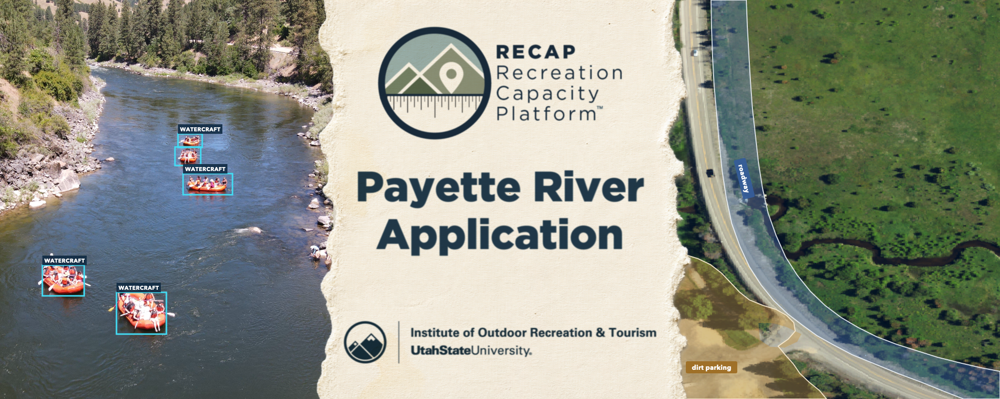

# RECAP-Payette

  

Reproducible, code-only workflows for deriving management-facing indicators in linear recreation corridors. This repository accompanies the Payette River computer-vision study and is part of the [RECAP platform](https://extension.usu.edu/iort/recap-platform/).

The repository contains three related workflows:

1. **Parking opportunity:** combine aerial imagery, roads, hydrography, terrain, human-reviewed Segment Anything Model (SAM) proposals, and semantic segmentation to map paved and dirt/gravel parking area.
2. **Camera activity:** train or apply a two-class object detector, track vehicle and watercraft detections, and calculate a detection-conditioned relative activity index by monitored site-hour.
3. **Post-hoc benchmarks:** compare DeepLabV3+ with U-Net and FPN on a common segmentation split, and compare YOLO26n with FCOS on a common detection partition.

## Choose the scientific contract first

| Contract | Use it for | Interpretation |
|---|---|---|
| `recommended` or parking `--contract corrected` | A new application or a defensible reanalysis | Uses provenance-bound inputs, spatially separated evaluation, complete monitoring grids, and explicit missingness. |
| `historical_replay` or parking `--contract historical` | Reconstructing the computations reported in the article | Preserves known paper-era choices and defects. It must be kept in a separate output directory and must not be relabeled as an independent validation. |
| `post-hoc benchmark` | Comparing model architectures under one controlled protocol | Diagnostic only. Benchmark fits do not replace the operational checkpoints or downstream article results. |

These contracts answer different questions. Do not mix their inputs, checkpoints, metrics, or output labels.

## What is not here

No aerial rasters, elevation rasters, camera photographs, annotation corpora, trained weights, site coordinates, or study-result tables are committed. Government geospatial inputs can be acquired from their source agencies; camera inputs and derived training artifacts require an independently governed archive. See [Data access and input contracts](docs/data-access.md).

Consequently, a public clone can reproduce the workflow mechanics but cannot, by itself, regenerate every number in the article. The exact-replay boundary and missing artifacts are stated in [Reproducibility status](docs/reproducibility.md).

## Start here

- [Quick start](docs/quickstart.md)
- [Parking-opportunity workflow](docs/parking-opportunity.md)
- [Camera-activity workflow](docs/camera-activity.md)
- [Outputs and interpretation](docs/outputs.md)
- [Post-hoc benchmarks](docs/benchmarks.md)
- [Privacy and responsible use](docs/privacy.md)

Every durable stage writes or consumes a manifest so that paths, parameters, checksums, package versions, and scientific contracts remain auditable. Paths in portable camera tables are archive-relative; large local inputs and all outputs are ignored by Git.

## License and citation

The source code is licensed under the [GNU Affero General Public License v3.0](LICENSE) (`AGPL-3.0-only`). Cite the software using [`CITATION.cff`](CITATION.cff) and cite the associated article when using its methods or reported results. The license applies to this repository's code; source datasets, model initializers, and user-provided inputs retain their own terms.
